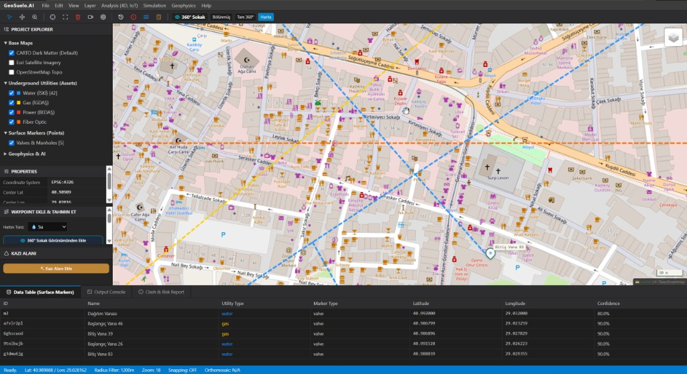

# 🌐 GeoSuelo.AI
### Yapay Zekâ Destekli Yeraltı Altyapı Haritalama, 360° Sokak İstasyonu ve Kazı Güvenlik Platformu

<p align="center">
  
</p>

<p align="center">
  
  
  
  
  
  
</p>

---

## 📌 Proje Hakkında

**GeoSuelo.AI**, şehirlerde ve şantiyelerde plansız kazı sebebiyle yaşanan elektrik, doğal gaz, su ve fiber kablo kopmalarını, patlamaları ve maliyetli gecikmeleri engellemek için geliştirilmiş yeni nesil bir **Yeraltı Risk Haritalama ve Kazı Güvenlik İstasyonudur**.

Klasik harita yazılımlarının getirdiği **"yalnızca kuş bakışı bakma"** kısıtını ortadan kaldırarak; sahada çalışan mühendis ve ekiplerin **360° sokak zemin seviyesinde (asfalt, rögar, kaldırım)** çalışmasını sağlar.

---

## ⚡ SubVysion (subvysion.com) İle Karşılaştırma: Biz Ne Yaptık, Farkımız Nedir?

[SubVysion](https://subvysion.com/), Y Combinator (W26) destekli bir yeraltı altyapı görüntüleme girişimidir ve altyapı hatlarını tespit etmek için çoklu sensörlü GPR (Yere Nüfuz Eden Radar) ve mobil AR kullanmaktadır.

**GeoSuelo.AI**, SubVysion'ın sektördeki boşluklarını kapatmak ve saha ekiplerine daha esnek, donanım-bağımsız bir mühendislik deneyimi sunmak üzere inşa edilmiştir:

| Özellik / Yaklaşım | 🏢 SubVysion (subvysion.com) | 🚀 GeoSuelo.AI (Bizim Yaklaşımımız) |
|---|---|---|
| **Donanım Zorunluluğu** | Milyonlarca liralık **özel, pahalı çoklu-sensör GPR radar araçları** ve özel saha operatörü gerektirir (Yüksek CAPEX). | **Donanımdan Bağımsız (Hardware-Agnostic / Zero Hardware Cost):** Yüzey bulguları (rögar, vana, yangın musluğu vb.) ve fotogrametri/LiDAR verileri üzerinden yapay zekâ ile yeraltı hatlarını topolojik modeller. |
| **Gözlem ve Waypoint Açısı** | Standart 2D harita ve mobil telefon kamerası bazlı yerel AR. | **360° İnteraktif Sokak Stüdyosu:** Kuş bakışı haritanın yetersiz kaldığı durumlarda doğrudan 360 derece sokak seviyesinde (1.65m göz hizası) asfalt üzerinde gezinebilir, zemine tıklayarak waypoint atabilirsiniz. |
| **API ve Lisans Maliyetleri** | Yüksek kurumsal abonelik ve veri işleme ücretleri. | **Sıfır API / Lisans Bağımlılığı:** Google Maps faturalandırma ve kredi kartı kısıtlarına takılmadan, açık kaynak CBS/vektör altyapısıyla çalışır. |
| **Mühendislik & CAD Ortamı** | Saha ekiplerine yönelik basit mobil/tablet arayüzü. | **Tam Teşekküllü CAD Çalışma İstasyonu:** Proje ağacı (Project Explorer), katman yönetimi, EPSG:4326 koordinat sistemi, konsol çıktısı, drone LiDAR (.LAS) ve 4D zaman makinesi entegrasyonu. |
| **Kazı Güvenliği & Çakışma (Clash Detection)** | Yalnızca var olan haritanın gösterimi. | **Canlı Ray-Casting Kazı Analizi:** Kullanıcının çizdiği serbest çokgen kazı alanlarını gerçek zamanlı tarayarak su, gaz, elektrik veya fiber hatlarıyla çakışmaları anında tespit eder ve kritik risk uyarısı üretir. |
| **Yeraltı Röntgeni (AR Subterranean)** | Donanımla kaydedilen radar yansımalarını gösterir. | **Hattı 3 Boyutlu Gösteren Röntgen Modu:** 360° sokak görünümünde asfaltın altından geçen boruları renkli neon ve derinlik etiketleriyle (`-1.4m İSKİ Su`) sanal olarak zeminin altında parlatır. |

---

## 🛠️ Temel Yetenekler (A'dan Z'ye)

### 1. 🥽 360° Sokak Görünümü & Zemin Waypoint Sistemi
* **Sokak Seviyesinde 360° Gezinme:** Farenizi sürükleyerek 360 derece sağa/sola (yaw) ve yukarı/aşağı (pitch) bakabilirsiniz.
* **Asfalt Raycasting:** Asfalt veya kaldırım üzerine geldiğinizde hedefleme çemberi bellek mesafesini ve kesin GPS koordinatını dinamik hesaplar.
* **Doğrudan Sokaktan Waypoint Atma:** *"📍 Başlangıç At"* veya *"🏁 Bitiş At"* butonlarına basıp sokaktaki kapağa tıkladığınız anda hem 360 görünümde 3D işaret bayrağı belirir hem de 2D CAD haritasında ilgili nokta kaydedilir.
* **Sokakta Adımlama:** *"İleri (5m)"* ve *"Geri (5m)"* kontrolleriyle cadde boyunca sanal olarak yürüyebilirsiniz.
* **AR Röntgen Modu:** Zemin altında kalan boruları sokak açısında parlayan çizgilerle derinlikleriyle birlikte gösterir.

### 2. 🗺️ Profesyonel CAD / GIS Harita İstasyonu
* **Bölünmüş Ekran (Split Screen):** Sol tarafta 360° Sokak Görünümü, sağ tarafta 2D CAD Haritası eş zamanlı çalışır. İstenildiğinde tek tıkla tam ekran haritaya veya tam ekran 360°'ye geçilebilir.
* **Zengin Altlık Haritalar:**
  * CARTO Dark Matter (Karanlık Mod)
  * Carto Voyager (Apple Tarzı Detaylı Şehir Haritası)
  * Esri Topoğrafik
  * Esri Uydu Görüntüsü
  * Standart OpenStreetMap

### 3. ⚡ Altyapı Hatları ve Renk Kodlaması
* 💧 **Su (İSKİ):** Mavi (`#1e90ff`)
* 🔥 **Doğalgaz (İGDAŞ):** Sarı (`#ffcc00`)
* ⚡ **Yüksek Gerilim / Elektrik (BEDAŞ):** Kırmızı (`#ff3333`)
* 🌐 **Fiber Optik (Telekom):** Turuncu (`#ff6600`)
* 💩 **Kanalizasyon:** Yeşil (`#33cc33`)

### 4. ⛏️ Serbest Çokgen Kazı Alanı & Canlı Çarpışma Analizi
* Harita üzerinde istenilen noktalar tıklanarak serbest çokgen (Polygon) kazı alanı çizilebilir.
* Geri al (↶) ve temizleme fonksiyonları mevcuttur.
* Kazı alanı 3 noktaya ulaştığında ray-casting algoritması devreye girer:
  * Alanın içinden bir boru/kablo geçiyorsa ekranda **"DİKKAT! Çizdiğiniz kazı alanı içerisinde Su Borusu tespit edildi! Olası Çarpışma Riski!"** uyarısı çıkar.

### 5. 🗑️ Kolay Waypoint & Çizim Yönetimi
* Haritadaki veya sokaktaki herhangi bir vana/rögar kapağının üzerine tıklandığında açılan pencereden **"🗑 Sil"** butonuna basılarak nokta anında hem ekrandan hem de veri tabanından tamamen kaldırılır.
* **"Eklenen (AI) Çizimleri Sil"** butonu ile oluşturulmuş sentetik tahmin hatları tek tıkla temizlenebilir.

---

## 🏗️ Teknoloji Mimarisi

* **Ön Yüz (Frontend):** React 18, TypeScript 5.9, Vite, TailwindCSS, Leaflet, React-Leaflet, Lucide Icons, Canvas 360 Projection Studio.
* **Arka Yüz (Backend):** Node.js, Express 5, PostGIS / PostgreSQL, Drizzle ORM, Zod Schema Validation.
* **Standartlar:** EPSG:4326 (WGS84) Coğrafi Koordinat Sistemi, GeoJSON LineString & Point Feature Collections.

---

## 🚀 Kurulum ve Çalıştırma

Projeyi yerel ortamınızda çalıştırmak için:

```bash
# 1. Repoyu klonlayın
git clone https://github.com/Arda-ERDEM/GEOSUELO.AI.git
cd GEOSUELO.AI

# 2. Bağımlılıkları yükleyin
pnpm install
# veya
npm install

# 3. API Sunucusunu derleyin ve başlatın
cd artifacts/api-server
node ./build.mjs
pnpm run start

# 4. Frontend uygulamasını başlatın
cd ../antigravity
pnpm run dev
```

Uygulama varsayılan olarak `http://localhost:5173` (veya Vite portunda) açılacaktır.

---

## 📡 API Uç Noktaları

* `GET /api/v1/markers`: Kayıtlı tüm yüzey işaretçilerini listeler.
* `POST /api/v1/markers`: Yeni yüzey işareti (vana, rögar, yangın musluğu) ekler.
* `DELETE /api/v1/markers/:id`: Belirtilen yüzey işaretini ve bağlı hatları siler.
* `GET /api/v1/assets`: Yeraltı hatlarını JSON formatında getirir.
* `GET /api/v1/assets.geojson`: CBS/BIM uyumlu GeoJSON formatında hatları döner.
* `POST /api/v1/predictions`: İki işaretçi ID'si arasında rota/hat tahmini oluşturur.
* `DELETE /api/v1/predictions`: Tüm AI tahmini hatları temizler.
* `POST /api/v1/zones`: Yeni kazı bölgesi çokgeni kaydeder.

---

## 📄 Lisans

Bu proje MIT lisansı ile korunmaktadır.
Telif Hakkı © 2026 Arda ERDEM - GeoSuelo.AI
